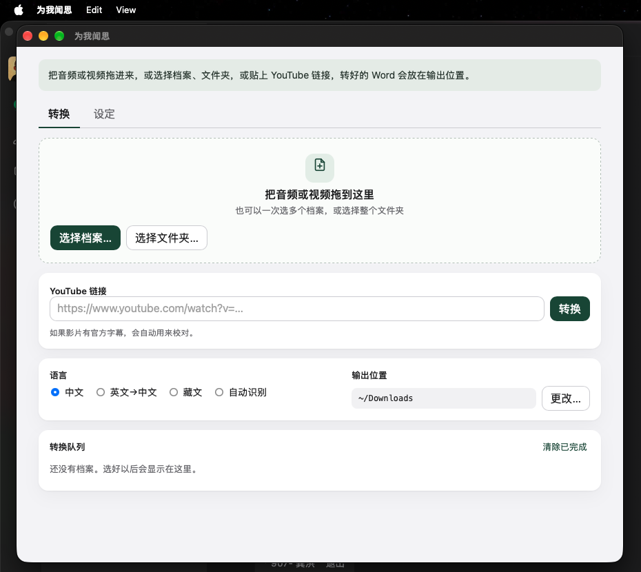

# 为我闻思（Wei Wo Wen Si） / speech2docx

本地语音转文字工具（macOS，Apple Silicon）。把 MP3 / M4A / WAV 等音频拖到应用图标或桌面文件夹，即会在「下载」文件夹生成排好版的 Word 文档（`.docx`）。

音频始终只在本机识别。可选的文字修饰可以使用本地大模型（LM Studio），或你已登录的 Claude / ChatGPT / Gemini 订阅，也可以改用 API 金钥。

---

**Wei Wo Wen Si** (为我闻思; traditional 為我聞思) is published in this repository as **speech2docx**.

Local speech-to-text for macOS on Apple Silicon. Drop an MP3, M4A, WAV, or a video (MP4, MOV, MKV, WEBM, …) onto the app icon or a Desktop folder and a formatted Word document appears in Downloads. Video files are converted by extracting the soundtrack first. If subtitles are embedded, sit in a sidecar file, or come from a YouTube URL, they are aligned with the ASR text for proofreading; unresolved disagreements are highlighted in yellow.

Audio is transcribed only on the machine. The first-run chooser preselects Local (LM Studio Qwen) so you can check accuracy before switching to a cloud model. The Word file contains only the title, the 来源 (source) line and the transcript; an optional appendix with the unpolished ASR text (附录：原始转录) can be turned on in Settings. English audio is transcribed, optionally proofread against English subtitles, then translated into Simplified Chinese with the Buddhist glossary (bodhicitta → 菩提心). The Word file is a two-column English/Chinese layout by default. Documents use a bundled typography template (A5, header banner, footer page numbers, 华文行楷 titles and 宋体 body). Choose your own template in Settings if you like. Optional polishing can use Local, or a signed-in Claude / ChatGPT / Gemini subscription, or an API key.

Speed (measured on an Apple M5 Pro, 64 GB): a 101.75-minute lecture took about 2.75 minutes without polishing and about 6.5 minutes with local Qwen polishing, so a 2-hour recording takes roughly 3 minutes, or about 8 minutes with polishing. Older or lower-memory Macs will be slower.

## 评测结果 Evaluation results

当前默认中文识别模型是 **r3**（Qwen3-ASR-1.7B 佛学 LoRA，MLX 8-bit），外加 `repetition_penalty=1.0`（rp1_tok1）解码和第七轮漏词补救（对可能漏字的片段切开重识别）。  
留出讲「佛教徒的生活模式」：严格分 92.05%，调整分 **97.56%**。四讲调整平均 **97.44%**。  
模型文件 SHA256：`0f7b16c8adde1b941624d97281afd08d2b7e10e38ecb9e01aabc878060a91085`。

完整的模型清单、分轮测试、对照表、计分规则和公开基准来源，见 [docs/ASR评测记录.md](docs/ASR评测记录.md)。下面是精简对照（严格分是对照听打稿的原规则；调整分是后来按「真逐字」规则重算的，两种口径不要直接相减）。

| # | 模型 / 轮次 | 测试集 | 严格分 | 调整分 | 采用？ |
| --- | --- | --- | ---: | ---: | --- |
| 1 | 原版 Qwen3-ASR-1.7B 8-bit | 生活模式（留出） | 76.41% | — | 否（已被 r1/r3 替换） |
| 2 | r1 佛学 LoRA 8-bit（3 讲、约 3.4 小时） | 生活模式（留出） | 87.33% | — | 曾采用，后被 r3 替换 |
| 3 | r2（第一、二册，新增约 0.6 小时） | 生活模式（留出） | 83.39% | — | 否（低于 r1） |
| 4 | **r3** 佛学 LoRA 8-bit（65 课、约 103 小时） | 生活模式（留出） | 88.02% | — | 是（权重仍用此版） |
| 5 | r3 + rp1_tok1（第五轮，只改解码） | 生活模式（留出） | 92.01% | 97.52% | 是（解码参数） |
| 5 | 同上 | 四讲平均 | — | 97.42% | 是 |
| 6 | r3 术语交叉核对 | 四讲 | 与 r3 相同 | 与 r3 相同 | 否（0 处替换） |
| 7 | r3 的 4-bit 量化 | 四讲平均 | — | 94.31% | 否（低于 8-bit 3.11 分） |
| 8 | **r3 + rp1_tok1 + 第七轮补字（当前默认）** | 生活模式（留出） | **92.05%** | **97.56%** | **是** |
| 8 | 同上 | 四讲平均 | — | **97.44%** | **是** |
| 9 | FireRed2-AED | 生活模式（留出） | 75.99%（beam 3）/ 76.07%（beam 5） | — | 否 |
| 10 | MiMo-V2.5 8-bit | 生活模式（留出） | 77.90% | — | 否 |
| 11 | FireRedASR2-LLM | 四讲调整平均 | — | 89.07% | 否 |
| 12 | Step-Audio 2 mini | 语加持前 7 段（提前停止） | — | 约 61% | 否 |

「—」表示当时没有按该口径公布分数。无法从对话或工作记录恢复的细节，在评测记录里标为「原始报告已删除」。

## 功能 Features

- **原字幕直出**：优先采用同名 SRT/VTT/ASS/SSA，其次提取内嵌文字字幕，直接生成同名 SRT 和当前模板的 Word，注明「本稿直接采用原字幕（信任原字幕），未经转写与校对」。跳过语音识别和润色。无可用文字字幕时沿用语音识别，不处理图像字幕或烧录字幕。

- **中文识别**：默认佛学微调版 r3（Qwen3-ASR-1.7B LoRA，MLX 8-bit）。留出讲调整分 97.56%，四讲调整平均 97.44%。详见 [评测记录](docs/ASR评测记录.md)
- **藏文识别**：`tenzin/whisper-small-tibetan-ct2`（faster-whisper）
- **长录音**：自动按约 8 分钟分片，可转 2 小时以上，支持中断后续传
- **转写速度**：在 Apple M5 Pro（64 GB）上实测，101.75 分钟的讲座不润稿约 2.75 分钟、加本地千问润稿约 6.5 分钟；换算成 2 小时音频，不润稿约 3 分钟，加润稿约 8 分钟。较旧或内存较小的 Mac 会慢一些。详见 [评测记录](docs/ASR评测记录.md)
- **视频输入**：可把 MP4 / MOV / MKV / WEBM 等视频拖到应用、桌面文件夹或命令行，会先抽出音轨再转写
- **字幕校对**：若视频有内嵌字幕、同名的 SRT/VTT/ASS，或命令行给出 YouTube 网址，会把字幕与识别结果对照；能确定的按字幕和佛教词库修正，无法确定的在 Word 里黄标，并写「校对说明」。YouTube 官方字幕优先，自动字幕会标明可信度较低
- **佛教词库**：可编辑的专有名词表，同时用于识别提示和文字修饰
- **自动修饰**：修正同音错字、去掉「啊 / 呃 / 嗯」、分段和标题；可加一段标明的「摘要」
- **只输出 DOCX**：Word 里只有标题、来源和正文，不写时长、转写时间、模型等信息；「附录：原始转录」默认关闭，可在设定中开启。识别初稿同时保存在本机日志目录
- **英文转中文**：英文录音先转成英文原文，再译成简体中文，佛教词库同样生效（例如 bodhicitta → 菩提心）。若有英文字幕会先校对英文再翻译。默认做成中英对照两栏，也可在设定里改成只出中文。桌面文件夹可把英文放进「英文」
- **固定版式**：输出套用内置 Word 模板（约 A5、页眉图案、页脚页码）。标题用华文行楷，讲者与「听打稿」用华文楷体，正文宋体，小节标题黑体。页眉左侧的册名已去掉。可在设定中改用自己的模板，或恢复默认版式
- **三种用法**：Dock 应用（拖文件）、桌面文件夹、命令行 `transcribe`
- **默认本机**：第一次使用预选「本地（LM Studio 千问）」，识别和修饰都在本机完成，方便先测准确度

## 环境要求 Requirements

- macOS，Apple Silicon
- Python 3.10+（建议 3.12）和 [Homebrew](https://brew.sh) 的 `ffmpeg`
- 本地修饰需要 [LM Studio](https://lmstudio.ai)，并载入 `qwen/qwen3.6-35b-a3b`（思考 / thinking 关闭），API 端口 `127.0.0.1:1234`
- 可选：Claude Code CLI、ChatGPT 自带的 Codex CLI、Gemini / Antigravity CLI

## 安装 Install

```bash
git clone <this-repo> speech2docx
cd speech2docx
./install.sh
```

安装脚本会：

1. 在 `~/ASR` 创建虚拟环境并安装依赖
2. 下载两个识别模型（已缓存则跳过）
3. 生成「为我闻思.app」，放到 `/Applications`（若无权限则放到 `~/Applications`），并加到 Dock
4. 安装登录时自动启动的文件夹监视（launchd）
5. 把 `transcribe` 链到 `~/.local/bin`

## 用法 Usage

点 Dock 或「应用程序」里的「为我闻思」，就会打开应用窗口。第一次使用默认已选「本地千问」，可在窗口的「设定」页随时更改。

把音频或视频拖进来，或选择档案、文件夹，或贴上 YouTube 链接，转好的 Word 会放在输出位置（默认为「下载」文件夹）。

Click the Dock or Applications icon to open the window. You can drop files onto the window, choose files or a folder, or paste a YouTube link. Finished Word documents go to the output folder (Downloads by default). Dragging files onto the Dock icon still works and will queue them in the same window.

### 使用方法 How to use

1. 打开「为我闻思」
2. 选择语言：中文、英文→中文，或藏文
3. 用下面任一方式加入内容：
   - 把档案拖到窗口里，或点「选择档案…」
   - 点「选择文件夹…」，处理文件夹里的音视频
   - 贴上 YouTube 链接，再点「转换」（有官方字幕时会用来校对）
4. 需要的话点「更改…」另选输出位置
5. 队列里会显示「等待 / 转录中 / 校对中 / 修饰中 / 完成 / 失败」。完成后可「打开文档」或「在 Finder 中显示」
6. 「设定」页可改修饰模型、附录、是否生成摘要或小节标题（默认关闭）、校对提示词、佛教词库和 Word 模板。校对提示词会放在修饰模型提示的最前面。

v3 深色界面，采用酒红侧栏与金色进度和操作控件。




### 应用图标 App icon

也可以把档案直接拖到 Dock 上的「为我闻思」图标，文件会加入同一窗口的队列。

### 桌面文件夹 Drop folders

`~/Desktop/语音转文字/`（文件夹名保持不变，与应用名不同）

- `中文`：用千问 ASR
- `藏文`：用藏文 Whisper
- 原文件会移到 `完成`
- Word 文档出现在 `~/Downloads`

### 命令行 CLI

```bash
transcribe lecture.mp3
transcribe lecture.mp4
transcribe https://www.youtube.com/watch?v=VIDEO_ID
transcribe lecture.mp3 --lang zh
transcribe lecture.mp3 --lang bo
transcribe lecture.mp3 --polish local
transcribe lecture.mp3 --polish none
transcribe --settings
```

## 修饰模型 Polishing models

| 选项 Option | 说明 |
| --- | --- |
| 本地 Local | LM Studio 中的千问，完全离线 |
| Claude | Claude Code 登录，或 Anthropic API 金钥 |
| GPT | Codex CLI（ChatGPT 登录），或 OpenAI API 金钥 |
| Gemini | Gemini / Antigravity CLI（Google 登录），或 Gemini API 金钥 |

金钥保存在 macOS 钥匙圈，不会写入设定文件或日志。云端不可用时会退回本地千问，并在文档里注明。默认模型编号写在 `~/ASR/config.json` 的 `models` 字段，可自行修改。

音频不会上传。只有转好的文字在你选择云端模型时才会发送。

## 佛教词库 Glossary

默认词库在仓库的 `佛教词库.txt`，安装后复制到 `~/ASR/佛教词库.txt`。一行一词，`#` 开头为注释。也可写成 `错词 -> 正词`。在设定里选择「编辑佛教词库」会用「文本编辑」打开该文件。

## 目录结构 Layout

```
~/ASR/                 运行数据（不进仓库）
  .venv/               虚拟环境
  config.json          用户设定（不含金钥）
  佛教词库.txt
  logs/                日志与识别初稿
  work/                分片缓存，可续传
  transcribe           命令行入口

speech2docx/           本仓库
  src/                 源代码
  scripts/             打包应用、图标
  launchd/             监视器模板
  templates/default.docx  版式模板（无讲课正文）
  ui/                    应用窗口界面
  docs/                  使用截图、ASR 评测记录
  install.sh
```

源代码中不硬编码某台电脑的用户路径，一律使用 `$HOME` / `$ASR_HOME`。

## 许可 License

MIT。见 [LICENSE](LICENSE)。

识别模型本身另有各自的许可证，请在使用前查看 Hugging Face 上的模型页：

- [mlx-community/Qwen3-ASR-1.7B-8bit](https://huggingface.co/mlx-community/Qwen3-ASR-1.7B-8bit)
- [tenzin/whisper-small-tibetan-ct2](https://huggingface.co/tenzin/whisper-small-tibetan-ct2)
